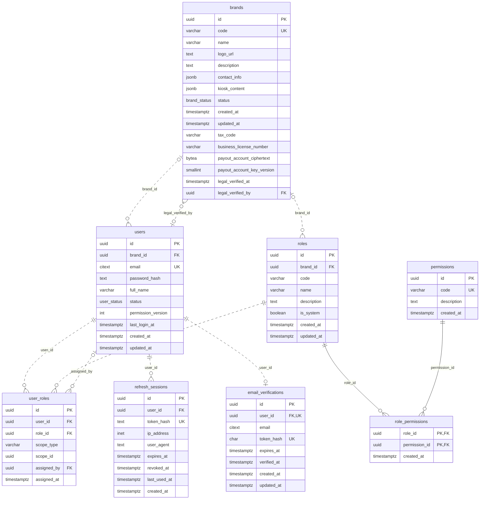
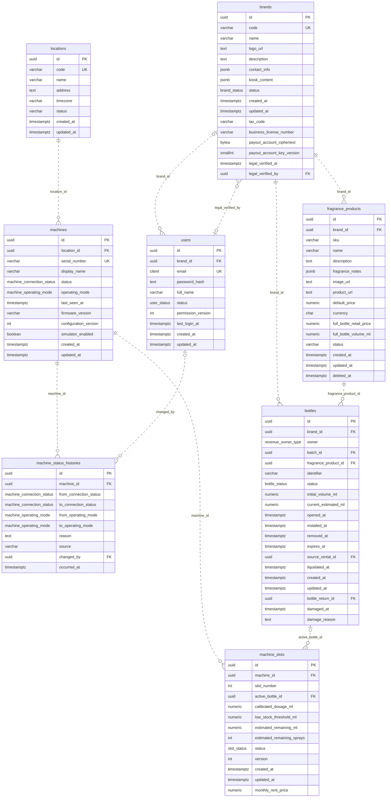
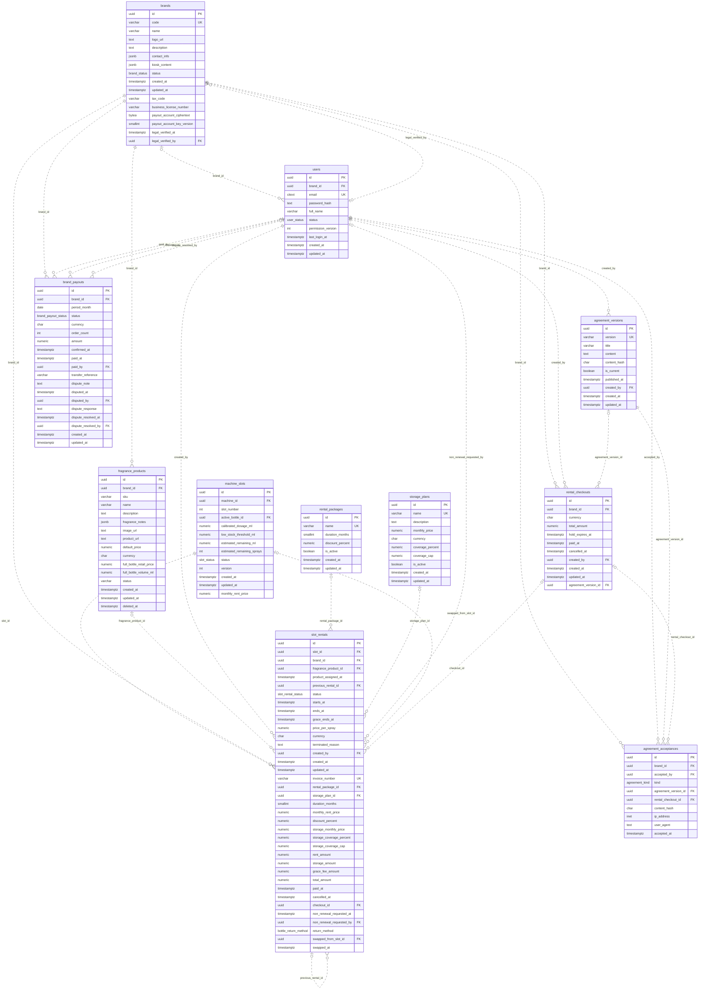
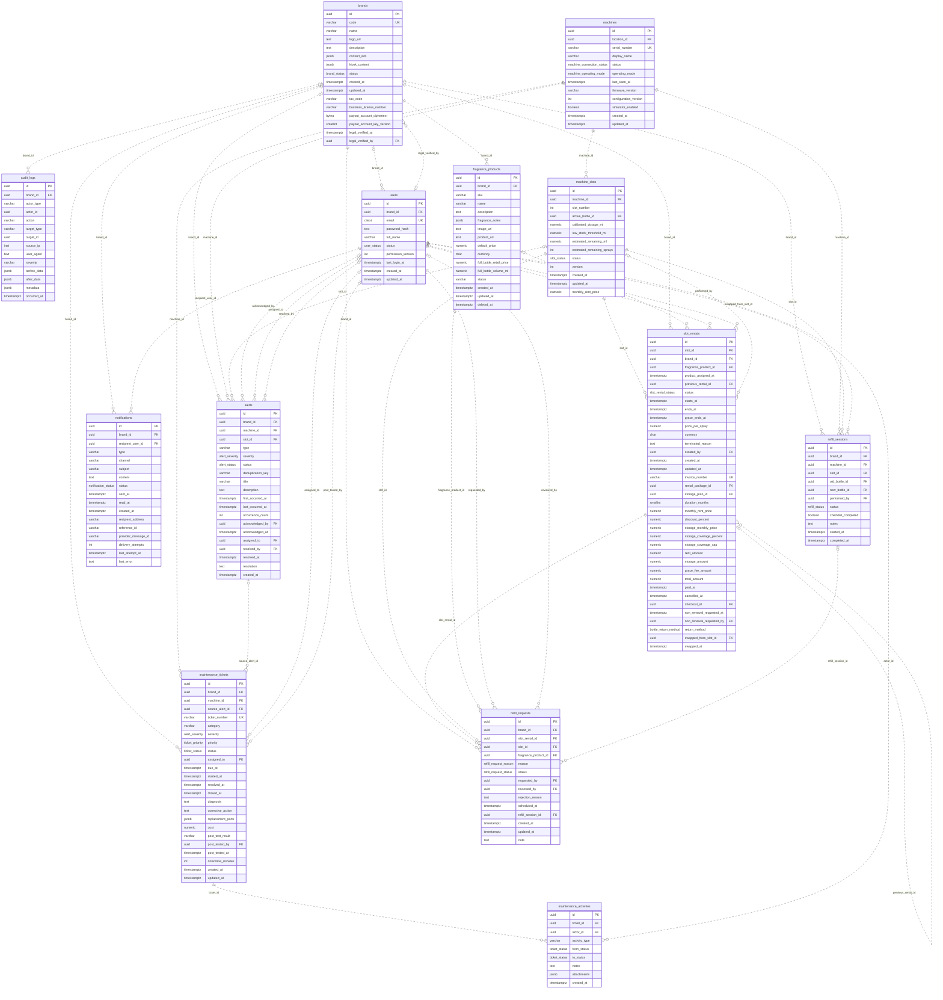
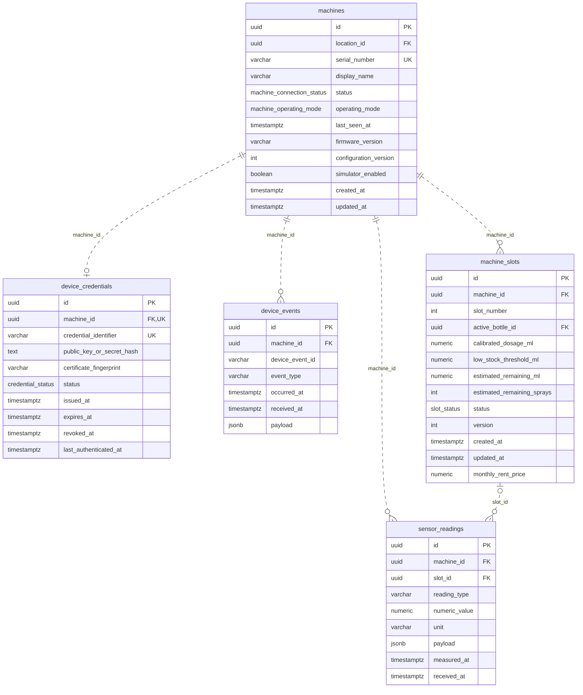

# ERD cho SDD — sinh từ spec/contracts/schema.sql

Bảng DEPRECATED `slot_rental_requests` và các cột DEPRECATED của `slot_rentals` (request_id, fixed_fee, revenue_share_percent) không vẽ (ADR-0006).
Bảng thuộc nhóm khác vẫn hiện đủ cột; mọi quan hệ giữa hai bảng cùng có mặt trên hình đều được vẽ, quan hệ tới bảng không có mặt xem ở nhóm khác.
Mọi khóa ngoại trong thiết kế đều được vẽ ít nhất một lần. Đường nét liền: khóa ngoại thuộc khóa chính (identifying); nét đứt: còn lại.
Kiểm bằng verify-erd: so với spec/contracts/data-dictionary.md — 44 bảng, 127 khóa ngoại, khớp cột, kiểu, PK/FK/UK và bản số.

## Identity and Brands

## Machines and Products

## Slot Rental

## Inventory

```mermaid
erDiagram
    brand_shipment_declarations {
        uuid id PK
        uuid brand_id FK
        uuid fragrance_product_id FK
        int declared_quantity
        numeric declared_bottle_volume_ml
        date expected_ship_date
        shipment_declaration_status status
        int received_quantity
        text discrepancy_notes
        uuid received_by FK
        timestamptz received_at
        uuid declared_by FK
        timestamptz created_at
        timestamptz updated_at
    }
    inventory_batches {
        uuid id PK
        uuid brand_id FK
        uuid fragrance_product_id FK
        uuid source_declaration_id FK
        varchar batch_number
        timestamptz received_at
        timestamptz expires_at
        int quantity_received
        jsonb supplier_info
        uuid created_by FK
        timestamptz created_at
        batch_authenticity_status authenticity_status
        varchar authenticity_document_url
        varchar authenticity_document_type
        uuid authenticity_submitted_by FK
        timestamptz authenticity_submitted_at
        uuid authenticity_verified_by FK
        timestamptz authenticity_verified_at
        text authenticity_rejection_reason
    }
    bottles {
        uuid id PK
        uuid brand_id FK
        revenue_owner_type owner
        uuid batch_id FK
        uuid fragrance_product_id FK
        varchar identifier
        bottle_status status
        numeric initial_volume_ml
        numeric current_estimated_ml
        timestamptz opened_at
        timestamptz installed_at
        timestamptz removed_at
        timestamptz expires_at
        uuid source_rental_id FK
        timestamptz liquidated_at
        timestamptz created_at
        timestamptz updated_at
        uuid bottle_return_id FK
        timestamptz damaged_at
        text damage_reason
    }
    bottle_returns {
        uuid id PK
        uuid slot_rental_id FK, UK
        uuid brand_id FK
        bottle_return_method return_method
        text shipping_address
        timestamptz ready_at
        timestamptz pickup_deadline
        timestamptz reminder_sent_at
        timestamptz handed_over_at
        uuid handed_over_by FK
        varchar recipient_name
        varchar tracking_number
        timestamptz forfeited_at
        uuid created_by FK
        timestamptz created_at
        timestamptz updated_at
    }
    refill_sessions {
        uuid id PK
        uuid brand_id FK
        uuid machine_id FK
        uuid slot_id FK
        uuid old_bottle_id FK
        uuid new_bottle_id FK
        uuid performed_by FK
        refill_status status
        boolean checklist_completed
        text notes
        timestamptz started_at
        timestamptz completed_at
    }
    inventory_adjustments {
        uuid id PK
        uuid brand_id FK
        uuid bottle_id FK
        uuid slot_id FK
        numeric before_quantity_ml
        numeric after_quantity_ml
        numeric difference_ml
        text reason
        uuid adjusted_by FK
        timestamptz created_at
    }
    storage_compensations {
        uuid id PK
        uuid brand_id FK
        uuid bottle_id FK, UK
        uuid slot_rental_id FK
        numeric bottle_retail_price
        numeric coverage_percent
        numeric amount
        char currency
        storage_compensation_status status
        varchar payout_reference
        uuid paid_by FK
        timestamptz paid_at
        timestamptz created_at
        timestamptz updated_at
    }
    brands {
        uuid id PK
        varchar code UK
        varchar name
        text logo_url
        text description
        jsonb contact_info
        jsonb kiosk_content
        brand_status status
        timestamptz created_at
        timestamptz updated_at
        varchar tax_code
        varchar business_license_number
        bytea payout_account_ciphertext
        smallint payout_account_key_version
        timestamptz legal_verified_at
        uuid legal_verified_by FK
    }
    fragrance_products {
        uuid id PK
        uuid brand_id FK
        varchar sku
        varchar name
        text description
        jsonb fragrance_notes
        text image_url
        text product_url
        numeric default_price
        char currency
        numeric full_bottle_retail_price
        numeric full_bottle_volume_ml
        varchar status
        timestamptz created_at
        timestamptz updated_at
        timestamptz deleted_at
    }
    users {
        uuid id PK
        uuid brand_id FK
        citext email UK
        text password_hash
        varchar full_name
        user_status status
        int permission_version
        timestamptz last_login_at
        timestamptz created_at
        timestamptz updated_at
    }
    slot_rentals {
        uuid id PK
        uuid slot_id FK
        uuid brand_id FK
        uuid fragrance_product_id FK
        timestamptz product_assigned_at
        uuid previous_rental_id FK
        slot_rental_status status
        timestamptz starts_at
        timestamptz ends_at
        timestamptz grace_ends_at
        numeric price_per_spray
        char currency
        text terminated_reason
        uuid created_by FK
        timestamptz created_at
        timestamptz updated_at
        varchar invoice_number UK
        uuid rental_package_id FK
        uuid storage_plan_id FK
        smallint duration_months
        numeric monthly_rent_price
        numeric discount_percent
        numeric storage_monthly_price
        numeric storage_coverage_percent
        numeric storage_coverage_cap
        numeric rent_amount
        numeric storage_amount
        numeric grace_fee_amount
        numeric total_amount
        timestamptz paid_at
        timestamptz cancelled_at
        uuid checkout_id FK
        timestamptz non_renewal_requested_at
        uuid non_renewal_requested_by FK
        bottle_return_method return_method
        uuid swapped_from_slot_id FK
        timestamptz swapped_at
    }
    machines {
        uuid id PK
        uuid location_id FK
        varchar serial_number UK
        varchar display_name
        machine_connection_status status
        machine_operating_mode operating_mode
        timestamptz last_seen_at
        varchar firmware_version
        int configuration_version
        boolean simulator_enabled
        timestamptz created_at
        timestamptz updated_at
    }
    machine_slots {
        uuid id PK
        uuid machine_id FK
        int slot_number
        uuid active_bottle_id FK
        numeric calibrated_dosage_ml
        numeric low_stock_threshold_ml
        numeric estimated_remaining_ml
        int estimated_remaining_sprays
        slot_status status
        int version
        timestamptz created_at
        timestamptz updated_at
        numeric monthly_rent_price
    }
    brands ||..o{ brand_shipment_declarations : "brand_id"
    fragrance_products ||..o{ brand_shipment_declarations : "fragrance_product_id"
    users |o..o{ brand_shipment_declarations : "received_by"
    users ||..o{ brand_shipment_declarations : "declared_by"
    brands ||..o{ inventory_batches : "brand_id"
    fragrance_products ||..o{ inventory_batches : "fragrance_product_id"
    brand_shipment_declarations |o..o{ inventory_batches : "source_declaration_id"
    users ||..o{ inventory_batches : "created_by"
    users |o..o{ inventory_batches : "authenticity_submitted_by"
    users |o..o{ inventory_batches : "authenticity_verified_by"
    brands ||..o{ bottles : "brand_id"
    inventory_batches ||..o{ bottles : "batch_id"
    fragrance_products ||..o{ bottles : "fragrance_product_id"
    slot_rentals |o..o{ bottles : "source_rental_id"
    brands ||..o{ refill_sessions : "brand_id"
    machines ||..o{ refill_sessions : "machine_id"
    machine_slots ||..o{ refill_sessions : "slot_id"
    bottles |o..o{ refill_sessions : "old_bottle_id"
    bottles |o..o{ refill_sessions : "new_bottle_id"
    users ||..o{ refill_sessions : "performed_by"
    brands ||..o{ inventory_adjustments : "brand_id"
    bottles ||..o{ inventory_adjustments : "bottle_id"
    machine_slots |o..o{ inventory_adjustments : "slot_id"
    users ||..o{ inventory_adjustments : "adjusted_by"
    brands ||..o{ storage_compensations : "brand_id"
    users |o..o{ storage_compensations : "paid_by"
    brands ||..o{ bottle_returns : "brand_id"
    users |o..o{ bottle_returns : "handed_over_by"
    users ||..o{ bottle_returns : "created_by"
    slot_rentals ||..o| bottle_returns : "slot_rental_id"
    bottles ||..o| storage_compensations : "bottle_id"
    slot_rentals ||..o{ storage_compensations : "slot_rental_id"
    bottle_returns |o..o{ bottles : "bottle_return_id"
    brands |o..o{ users : "brand_id"
    brands ||..o{ fragrance_products : "brand_id"
    machines ||..o{ machine_slots : "machine_id"
    machine_slots ||..o{ slot_rentals : "slot_id"
    brands ||..o{ slot_rentals : "brand_id"
    fragrance_products |o..o{ slot_rentals : "fragrance_product_id"
    slot_rentals |o..o{ slot_rentals : "previous_rental_id"
    users ||..o{ slot_rentals : "created_by"
    users |o..o{ slot_rentals : "non_renewal_requested_by"
    machine_slots |o..o{ slot_rentals : "swapped_from_slot_id"
    bottles |o..o{ machine_slots : "active_bottle_id"
    users |o..o{ brands : "legal_verified_by"
```

## Orders and Payments

```mermaid
erDiagram
    orders {
        uuid id PK
        uuid brand_id FK
        uuid slot_rental_id FK
        revenue_owner_type revenue_owner
        uuid machine_id FK
        uuid slot_id FK
        uuid fragrance_product_id FK
        varchar product_name_snapshot
        numeric amount
        char currency
        order_status status
        varchar payment_reference UK
        varchar idempotency_key UK
        timestamptz expires_at
        timestamptz paid_at
        timestamptz dispensed_at
        varchar failure_code
        boolean needs_manual_review
        uuid manual_review_resolved_by FK
        timestamptz manual_review_resolved_at
        timestamptz created_at
        timestamptz updated_at
    }
    order_status_histories {
        uuid id PK
        uuid brand_id FK
        uuid order_id FK
        order_status from_status
        order_status to_status
        text reason
        jsonb metadata
        varchar actor_type
        uuid actor_id
        timestamptz occurred_at
    }
    payments {
        uuid id PK
        uuid brand_id FK
        uuid order_id FK
        varchar provider
        varchar provider_transaction_id
        varchar provider_reference
        numeric amount
        char currency
        payment_status status
        jsonb raw_response
        timestamptz paid_at
        timestamptz created_at
        timestamptz updated_at
        uuid rental_checkout_id FK
    }
    payment_events {
        uuid id PK
        uuid brand_id FK
        uuid payment_id FK
        varchar provider
        varchar provider_event_id
        varchar payload_hash
        boolean signature_valid
        jsonb payload
        varchar processing_result
        timestamptz received_at
        timestamptz processed_at
    }
    dispense_commands {
        uuid id PK
        uuid brand_id FK
        uuid order_id FK
        uuid machine_id FK
        uuid slot_id FK
        dispense_type command_type
        varchar command_token UK
        text signature
        command_status status
        timestamptz expires_at
        timestamptz sent_at
        timestamptz acknowledged_at
        timestamptz completed_at
        int retry_count
        uuid created_by FK
        timestamptz created_at
    }
    dispense_results {
        uuid id PK
        uuid brand_id FK
        uuid command_id FK, UK
        boolean success
        varchar result_code
        varchar failure_code
        timestamptz executed_at
        timestamptz received_at
        jsonb sensor_snapshot
        jsonb raw_payload
        varchar device_event_id
    }
    kiosk_interaction_events {
        uuid id PK
        varchar event_id UK
        kiosk_interaction_type event_type
        uuid brand_id FK
        uuid slot_rental_id FK
        uuid machine_id FK
        uuid slot_id FK
        uuid fragrance_product_id FK
        uuid kiosk_session_id
        timestamptz occurred_at
        timestamptz received_at
    }
    refund_claims {
        uuid id PK
        uuid order_id FK, UK
        uuid brand_id FK
        refund_claim_status status
        boolean refund_order
        numeric amount
        char currency
        bytea account_ciphertext
        bytea contact_ciphertext
        smallint pii_key_version
        timestamptz consented_at
        uuid assigned_to FK
        timestamptz assigned_at
        varchar payout_reference
        text resolution_note
        uuid resolved_by FK
        timestamptz created_at
        timestamptz updated_at
        timestamptz closed_at
        timestamptz account_purged_at
        timestamptz contact_purged_at
    }
    brands {
        uuid id PK
        varchar code UK
        varchar name
        text logo_url
        text description
        jsonb contact_info
        jsonb kiosk_content
        brand_status status
        timestamptz created_at
        timestamptz updated_at
        varchar tax_code
        varchar business_license_number
        bytea payout_account_ciphertext
        smallint payout_account_key_version
        timestamptz legal_verified_at
        uuid legal_verified_by FK
    }
    slot_rentals {
        uuid id PK
        uuid slot_id FK
        uuid brand_id FK
        uuid fragrance_product_id FK
        timestamptz product_assigned_at
        uuid previous_rental_id FK
        slot_rental_status status
        timestamptz starts_at
        timestamptz ends_at
        timestamptz grace_ends_at
        numeric price_per_spray
        char currency
        text terminated_reason
        uuid created_by FK
        timestamptz created_at
        timestamptz updated_at
        varchar invoice_number UK
        uuid rental_package_id FK
        uuid storage_plan_id FK
        smallint duration_months
        numeric monthly_rent_price
        numeric discount_percent
        numeric storage_monthly_price
        numeric storage_coverage_percent
        numeric storage_coverage_cap
        numeric rent_amount
        numeric storage_amount
        numeric grace_fee_amount
        numeric total_amount
        timestamptz paid_at
        timestamptz cancelled_at
        uuid checkout_id FK
        timestamptz non_renewal_requested_at
        uuid non_renewal_requested_by FK
        bottle_return_method return_method
        uuid swapped_from_slot_id FK
        timestamptz swapped_at
    }
    machines {
        uuid id PK
        uuid location_id FK
        varchar serial_number UK
        varchar display_name
        machine_connection_status status
        machine_operating_mode operating_mode
        timestamptz last_seen_at
        varchar firmware_version
        int configuration_version
        boolean simulator_enabled
        timestamptz created_at
        timestamptz updated_at
    }
    machine_slots {
        uuid id PK
        uuid machine_id FK
        int slot_number
        uuid active_bottle_id FK
        numeric calibrated_dosage_ml
        numeric low_stock_threshold_ml
        numeric estimated_remaining_ml
        int estimated_remaining_sprays
        slot_status status
        int version
        timestamptz created_at
        timestamptz updated_at
        numeric monthly_rent_price
    }
    fragrance_products {
        uuid id PK
        uuid brand_id FK
        varchar sku
        varchar name
        text description
        jsonb fragrance_notes
        text image_url
        text product_url
        numeric default_price
        char currency
        numeric full_bottle_retail_price
        numeric full_bottle_volume_ml
        varchar status
        timestamptz created_at
        timestamptz updated_at
        timestamptz deleted_at
    }
    users {
        uuid id PK
        uuid brand_id FK
        citext email UK
        text password_hash
        varchar full_name
        user_status status
        int permission_version
        timestamptz last_login_at
        timestamptz created_at
        timestamptz updated_at
    }
    rental_checkouts {
        uuid id PK
        uuid brand_id FK
        char currency
        numeric total_amount
        timestamptz hold_expires_at
        timestamptz paid_at
        timestamptz cancelled_at
        uuid created_by FK
        timestamptz created_at
        timestamptz updated_at
        uuid agreement_version_id FK
    }
    brands ||..o{ orders : "brand_id"
    slot_rentals ||..o{ orders : "slot_rental_id"
    machines ||..o{ orders : "machine_id"
    machine_slots ||..o{ orders : "slot_id"
    fragrance_products ||..o{ orders : "fragrance_product_id"
    users |o..o{ orders : "manual_review_resolved_by"
    brands ||..o{ order_status_histories : "brand_id"
    orders ||..o{ order_status_histories : "order_id"
    brands ||..o{ payments : "brand_id"
    orders |o..o{ payments : "order_id"
    brands |o..o{ payment_events : "brand_id"
    payments |o..o{ payment_events : "payment_id"
    brands |o..o{ dispense_commands : "brand_id"
    orders |o..o{ dispense_commands : "order_id"
    machines ||..o{ dispense_commands : "machine_id"
    machine_slots ||..o{ dispense_commands : "slot_id"
    users |o..o{ dispense_commands : "created_by"
    brands |o..o{ dispense_results : "brand_id"
    dispense_commands ||..o| dispense_results : "command_id"
    brands ||..o{ kiosk_interaction_events : "brand_id"
    slot_rentals ||..o{ kiosk_interaction_events : "slot_rental_id"
    machines ||..o{ kiosk_interaction_events : "machine_id"
    machine_slots ||..o{ kiosk_interaction_events : "slot_id"
    fragrance_products ||..o{ kiosk_interaction_events : "fragrance_product_id"
    brands ||..o{ refund_claims : "brand_id"
    users |o..o{ refund_claims : "assigned_to"
    users |o..o{ refund_claims : "resolved_by"
    orders ||..o| refund_claims : "order_id"
    rental_checkouts |o..o{ payments : "rental_checkout_id"
    brands |o..o{ users : "brand_id"
    brands ||..o{ fragrance_products : "brand_id"
    machines ||..o{ machine_slots : "machine_id"
    brands ||..o{ rental_checkouts : "brand_id"
    users ||..o{ rental_checkouts : "created_by"
    machine_slots ||..o{ slot_rentals : "slot_id"
    brands ||..o{ slot_rentals : "brand_id"
    fragrance_products |o..o{ slot_rentals : "fragrance_product_id"
    slot_rentals |o..o{ slot_rentals : "previous_rental_id"
    users ||..o{ slot_rentals : "created_by"
    users |o..o{ slot_rentals : "non_renewal_requested_by"
    machine_slots |o..o{ slot_rentals : "swapped_from_slot_id"
    users |o..o{ brands : "legal_verified_by"
    rental_checkouts |o..o{ slot_rentals : "checkout_id"
```

## Operations

## Device and IoT

